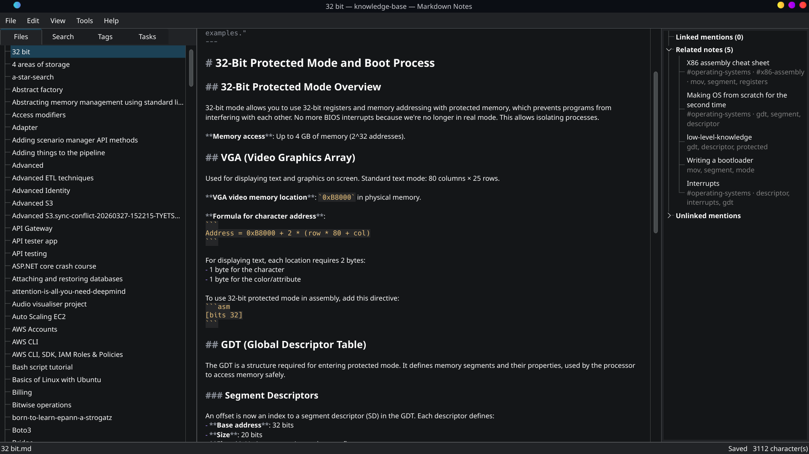

# Markdown Notes

A fast, native desktop editor for Obsidian vaults, for Linux (Wayland) and Windows. Qt Widgets, no web views. It has been designed to be pretty much fully compatible with existing Obsidian vaults.



## Build

Needs CMake ≥ 3.25, Ninja, a C++20 compiler and Qt ≥ 6.5. Everything else is in `third_party/`.

```sh
cmake --preset release && cmake --build --preset release
./build/release/src/markdown-notes [vault-folder]
ctest --preset debug    # tests (after building the debug preset)
```

To install for the current user on Linux (launcher entry, icon and a Meta+Shift+N quick-capture shortcut on KDE), run `./install.sh`. Options: `--appimage FILE`, `--desktop-icon`, `--uninstall`.

Packaging: `packaging/linux/build-appimage.sh` (AppImage) and `packaging/windows/build-zip.ps1` (portable zip).

## Beyond Obsidian

- **Vault health** (Tools): broken links, orphan and empty notes, unused attachments, similar tags, near-duplicate notes, and notes missing category tags.
- **Passage search:** Search › Passages returns matching sections rather than whole notes, sortable by date. `#tag` filters apply per passage.
- **Related notes** and **related passages** for the current paragraph, in the right panel.
- **Tasks** tab: all `- [ ]` items in the vault, with due dates (`2025-01-31` or `due:2025-01-31`). Tasks can be completed or deleted from the list.
- **Properties as a form, not YAML:** Ctrl+N (new note) and Ctrl+T (Edit › Properties) show the note's properties as a form: category dropdowns, a fuzzy tag picker that lists near-duplicates together, status choices, summary, aliases and sources (one per line), and created (today on new notes). A link on the clipboard becomes a new note's source. Only changed values are written, other properties are left alone, and blank fields can be written empty so every note has the same keys. With the assistant, Suggest fills the empty fields. The property list is set in Vault settings › Properties and tags. Typing in a frontmatter `tags:` list autocompletes too.
- **Tags:** filter, sort and pin tags; selecting a tag shows its notes grouped by their other tags. Frontmatter properties such as `primary` / `secondary` can count as tags, and with category tags configured, new notes (Ctrl+N) offer them as dropdowns.
- **Link suggestions:** mentions of note names are underlined while typing; Alt+Enter converts one to a link.
- **Calendar** (left tab): a dot on each day with a journal note (tagged `journal`, dated by file name or `created`). Click a day to open its note; an empty day offers a new daily note.
- **Home page** (View › Home, Ctrl+Shift+H; shown when no note is open): today's note and a capture box, active notes (any note with a status; a hub note counts its linked notes and their tasks), tasks due, recently edited notes, categories with their main topics, notes that need properties, and journal notes from this day. Sections are chosen in Vault settings › Home.
- **Smart lists:** Enter continues a list, Tab / Shift+Tab indent and outdent items, numbered lists renumber themselves, Ctrl+L toggles a checkbox. Alt+Shift+T puts a timestamp (`14:32 - `) at the start of the line.
- **Smart paste:** a URL pasted over selected text makes a link; rich text from a web page or document is converted to Markdown (Ctrl+Shift+V pastes plain text).
- **Export** (File › Export): the note as rendered, to PDF or a standalone HTML file with images embedded.
- **Today's note** (Alt+D, or `markdown-notes --today`): opens today's daily note, creating it first with the daily-note tags (`journal` by default, set in Vault settings).
- **Quick capture:** `markdown-notes --capture` appends a line to `Inbox.md` or today's daily note. Paste images or draw (Ctrl+D) in the box, or double-click an image to draw on it; they are saved to the attachment folder and embedded.
- **Appearance** (View): theme, accent colour, fonts and line length.

## AI assistant (optional)

Configure an OpenAI-compatible server (Ollama, LM Studio, llama.cpp, vLLM) in **Tools › AI assistant settings**. Note content is sent only to that server, and notes are only changed when you apply a suggestion.

- **Suggest properties** (Ctrl+Shift+M, or Suggest in the Properties form): fills the form's empty fields with categories, tags and a summary for you to review; existing values are kept.
- **Ask** (Ctrl+Shift+A): answers questions from your notes, with cited sources.
- **Semantic search:** with an embedding model, Search › Meaning matches passages by meaning as well as keywords. Passages are indexed in the background.

For llama.cpp, which serves one model per process, set "Embedding server" separately. Build with `-DMN_AI=OFF` to exclude the assistant and Qt Network.

## Keys

| Key | Action |
|---|---|
| Ctrl+O | Quick switcher (Shift+Enter creates a note) |
| Ctrl+Shift+F | Search |
| Ctrl+E | Reading view |
| Ctrl+N / F2 | New note (name and properties) / rename (updates links) |
| Ctrl+T | The note's properties |
| Ctrl+F / Ctrl+H | Find / replace |
| Alt+D | Today's note |
| Ctrl+Shift+H | Home page |
| Alt+Shift+T | Timestamp at the start of the line |
| Ctrl+L | Toggle checkbox |
| Tab / Shift+Tab | Indent / outdent list items |
| Ctrl+Shift+V | Paste as plain text |
| Ctrl+Shift+C | Quick capture |
| Ctrl+Shift+M / A | Suggest properties / ask your notes |
| Ctrl+Shift+B / R | Toggle left / right panel |
| Alt+Left / Right | Back / forward |
| Ctrl+click | Follow link (creates missing notes) |

## Licence

MIT. Third-party licences are in [THIRD_PARTY_NOTICES.md](THIRD_PARTY_NOTICES.md); Qt is LGPL, linked dynamically.
